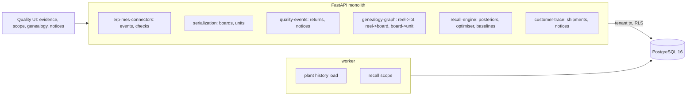

# AI Product Recall & Global Traceability

For a manufacturer whose supplier has just written to say a component lot is bad: it works out which finished units really hold a part
from that lot, from shop-floor records that are wrong in the ways real records are wrong, with a probability for every unit; picks the
cheapest recall that leaves no defensible doubt; and says which customers and shipments to notify. The plant's own deterministic answers
are scored alongside it.

Built from blueprint 16 of "Advanced Engineering Build Book, Volume IV" as a **vertical slice**: the demo scenario end to end, with the
platform parts real and the rest listed under [Not built](#not-built-and-why).

**The plant, its records, the supplier, the customers, the field returns and the defect are generated by a simulator in this repository.
No company, product or person here is real. The simulator also knows the truth (which units really hold a bad capacitor), which no
model or baseline sees; it is used only to score them.**

## Run it

```bash
docker compose up --build        # migrates, seeds, serves http://localhost:8380/ui/ with one worker
docker compose run --rm test     # 9 tests against a throwaway database
```

Open http://localhost:8380/ui/ and press **Run all steps** (about 6 seconds), or `make bootstrap demo`.
Demo tokens (local only): `arden-head_of_quality-demo`, `arden-quality_engineer-demo`, `arden-viewer-demo`. Run `make reset` before a second demo run.

## The demo, step by step

1. **Sixty days of drive units.** An invented e-bike drive-unit plant: three SMT lines put four DC-link capacitors from one supplier on
   every controller board, each board goes into a drive unit, and units ship to eight customers: 41,760 boards, 40,091 units, 150 reels
   in 15 supplier lots, 188 shipments, 351 field returns. The records carry the flaws: 15 of 150 lot codes unread or matching no ship
   notice, 16 date codes unread, a reel change on line 1 or 2 never scanned, 343 of 1,246 rework tickets without the replacement
   board's serial. Eight new events arrive; two are recorded and six refused (a replay, a board already fitted, an unknown board, a
   rework out of order, a timestamp after the plant's clock, a reel never issued to that line).
2. **The supplier's notice.** Kestrel Components (invented) says lot B-177, date codes 5 to 9 July, may fail. Before anything is
   recalled the returns are checked against the claim. Per 1,000 unit-days in the field, units the MES links to B-177 come back 4.7
   times as often as the rest (90%: 3.8–5.8); every other lot is near 1. Within B-177, units on reels dated 5 to 9 July return at
   1.4–1.8 per 1,000 unit-days and the 4 July reels at 0.1. The 8 July reel is missing from the MES's view: receiving read its code as
   `B-171`.
3. **The smallest defensible recall.** The scope job learns how the records go wrong, puts a probability on every unit and chooses
   the cheapest set that leaves out no unit above 1% and less than half an affected unit in expectation: **2,874 units, $444k**, 0.08
   expected affected units left out. On the truth (2,810 affected units) it misses none and recalls 64 unaffected. The MES serial
   genealogy recalls 2,819 units for $446k but misses 492 affected units (450 on the misread reel) and recalls 501 unaffected (mostly
   because an unread date code counts as suspect). Whole work orders: 3,564 units, $568k, 484 missed. Every unit built while B-177
   was on a line: 8,548 units, $1,478k, 475 missed. Avoided cost against the broad recall: $1,034k.
4. **Three units, traced.** A board at a splice the operator scanned 26 seconds after the board was finished: the MES gives it to the
   old B-177 reel; the model says 48%; the truth is the new B-178 reel. A unit whose rework ticket lost the board: the model spreads it
   over 8 spares, 7 of them suspect (87%), and recalls it, although the true board is not among the eight. A unit on the misread reel:
   certain for the model, invisible to the MES.
5. **Approval and notices.** The engineer who scoped the recall cannot approve it; the head of quality does. Notices for 8 customers
   (2,861 units across their shipments, as JSON and CSV) and a hold list of 13 units still in the warehouse. All in a hash-chained
   audit log.

## Architecture



| Piece | How it works |
|---|---|
| Simulator (`rc/world.py`) | Supplier lots of 8–12 reels, each reel with a date code, arriving in deliveries of one or two lots with an advance ship notice (reels per date code). Three lines at 232 boards a day each; stores issue the oldest lot's reels, a quarter of the time the next lot's; each reel's usable count varies with pick-up losses; at a splice the board can hold parts from both reels. Every 25th board is a spare; units failing the end-of-line test get one of the five oldest spares. Shipping daily to two to four of eight customers. Defective units return at about eight times the base rate. Record flaws: per-character misreads and unread codes at receiving, unread date codes, reel scans from a few minutes before the splice to about forty after (line 3 has splice sensors and a quicker crew), 3% of scans forgotten, a quarter of rework tickets without the board's serial. |
| Reel -> lot | The read code's likelihood under each lot in the delivery (each character survives with 1 − q, a misread becomes one particular wrong character out of about 30), with q learned from deliveries of a single lot; the exact posterior under the notice's counts (which reels are lot A is a subset; marginals by elementary symmetric polynomials). |
| Reel -> date code | Read, or the share of the notice's window count not taken by reels read inside it. |
| Reel -> board | Splice time from line 3's sensor, else from the scan minus a delay drawn from line 3's empirical delays (with exponential tails), else, for a forgotten scan, from the board count since the neighbouring splices; P(board holds reel i) = P(splice i before the board ends) × P(splice i+1 after it starts). |
| Board -> unit | The recorded board or replacement; for a ticket without a serial, uniform over the 8 oldest spares the model believes are still on the shelf. |
| Optimiser | Everything above 1% is in. Below it, leave out the units that save the most cost per unit of risk until the expected number of affected units left out reaches 0.5. Cost by where the unit is: warehouse $18, at a customer $95, on a rider's bike $380, with the share on bikes rising with time since shipping. |
| Baselines | The MES: last scan before the board, exact code match, unread date code counted as suspect, removed board kept when the ticket lost the new one. Whole work orders containing a suspect board. Every unit built between the first and last board on any B-177 reel. |
| Platform | Row-level security per tenant, Postgres job queue, Idempotency-Key replay, hash-chained audit log, four-eyes approval, `/metrics`. |

## Data model

`migrations/002_trace.sql` follows the blueprint (material_batch, component_lot, serial_unit, assembly_event, shipment,
customer_delivery, quality_event, genealogy_edge, recall_case, recall_scope, plus the core model_artifact and decision_record);
additions are marked `(+)`: a plant row (seed and clock), the reel's read lot code, date code and delivery, the board fitted at build.
A reel's `material_batch_id` stays empty on purpose: which lot it came from is an inference, kept in `genealogy_edge` with its
probability and model version.

## API

| Method | Endpoint | Purpose |
|---|---|---|
| POST | `/v1/events/assembly` | 202 + job: load the synthetic plant history; or new events, each checked |
| GET | `/v1/plant` | (+) Counts and how good the records are |
| POST | `/v1/quality/incidents` | A supplier notice for a lot and a window of date codes, with the returns evidence |
| POST | `/v1/recalls/scope` | 202 + job: posteriors, the optimiser, the baselines, the genealogy edges |
| GET | `/v1/recalls/{id}/impact` | The set against every alternative, customers, stages, uncertain units, the fit |
| GET | `/v1/units/{serial}/genealogy` | One unit's boards, reels, lots and where it went, with probabilities |
| POST | `/v1/recalls/{id}/approve` | (+) Four-eyes approval |
| POST | `/v1/notices/export` | Customer notices for an approved recall, JSON and CSV |

Contract: [`docs/openapi.json`](docs/openapi.json).

## Measured

[`docs/evaluation.md`](docs/evaluation.md) (`python -m rc.evaluate`, three plants the demo never uses, 2 seconds) and
[`docs/performance.md`](docs/performance.md).

| | Model | MES serial genealogy | Whole work orders | Broad (while B-177 was on a line) |
|---|---|---|---|---|
| Affected units missed (of 2,816–3,268) | 0–1 | 35–486 | 30–477 | 29–477 |
| Unaffected units recalled | 52–67 | 45–504 | 1,186–1,453 | 2,472–5,646 |
| Cost | $428k–$499k | $385k–$566k | $468k–$727k | $823k–$1,281k |

Calibration over the three plants: units the model put between 25% and 75% were affected 59% of the time (mean prediction 54%);
between 5% and 25%, 18% (mean 19%).

Where it breaks, also measured, because the model leans on three things it cannot check:

| The simulator changed to | Model affected missed (three plants) | Model's own expected misses |
|---|---|---|
| As built | 1 | 0.28 |
| Reworks take any spare on the shelf, not one of the five oldest | 69 | 0.26 |
| Lines 1–2 scan three times later than line 3 | 19 | 0.27 |
| Every ship notice claims one reel more than arrived | 1 (but 1,283 more units recalled) | 0.70 |

The model's confidence does not fall when its assumptions do: with spares handed out at random it still expects a quarter of a missed
unit and misses 69. The rework shelf model is the weakest piece, and a stores ticket audit is the fix, not more modelling.

## The hardest tradeoff

What "defensible" means. A recall that leaves out no unit with any chance of a bad part is the broad recall, three times the cost; a
recall of the units the records say are affected is the MES's, as cheap as the model's and wrong by hundreds of units in both
directions. The policy here is explicit and stored with every decision: nothing above 1% is left out, and the expected number of
affected units left out stays under half a unit. Both numbers are parameters the head of quality approves, the page shows how cost and
misses move with them (the evaluation's policy table), and the approval is refused to the person who ran the scope.

## Threat model (summary)

| Threat | Mitigation here | Gap |
|---|---|---|
| A bad or replayed MES event changing the genealogy | Each event checked on its own: replays by source id, unknown boards and reels, boards already fitted, out-of-order rework, future times; the batch audited | No signature from the MES; no event correction workflow |
| A recall scoped on a wrong notice | The returns evidence per lot and date code is shown before the scope; unknown lots and windows outside the lot refused | The notice itself is not authenticated |
| Notices going out for an unreviewed scope | Notices only for an approved recall; four-eyes approval; the model version marked approved with it | |
| One manufacturer seeing another's units | Row-level security on every table; tested through the API and directly in the database | |

## Not built, and why

- **Quality anomaly clustering**: the blueprint asks for it; here the returns are checked against the notice with an exposure-adjusted
  rate ratio per lot and date code, which is the question the demo needs answered. Clustering returns by symptom and genealogy to find
  an unannounced bad lot is the next piece.
- **Multi-tier BOMs**: one tier (supplier lot -> reel -> board -> unit) with split (lots across reels and lines), merge (splices),
  and rework. A second tier would chain the same posteriors.
- **Real ERP/MES connectors, EPCIS, GS1 parsing**: the generator stands in so every scope can be scored against the truth.
- **Deliveries of three or more lots**: the exact lot posterior handles two; three would need Sinkhorn scaling or sampling.
- **Kafka, Redis, OpenTelemetry, Grafana, MLflow, Terraform, CI, SSO, a Next.js front end**: not needed to prove the slice; no cloud account used.

## Commercial sketch

Buyer: automotive, medical device, food and electronics manufacturers, and their contract manufacturers. Pricing shape from the
blueprint: per plant or per serialized unit traced, an enterprise recall-readiness licence, and per-incident scoping for smaller makers.

## Layout

```
core/        platform kit: db + RLS, jobs, audit chain, HTTP, scenario runner, load test
rc/          world (plant, records, truth), engine (record models, posteriors, optimiser, baselines, returns), api, seed, evaluate
migrations/  forward-only SQL          web/   UI, scenario.json, demo.json (recorded run)
tests/       9 tests                   docs/  evaluation.md, performance.md, openapi.json
```
